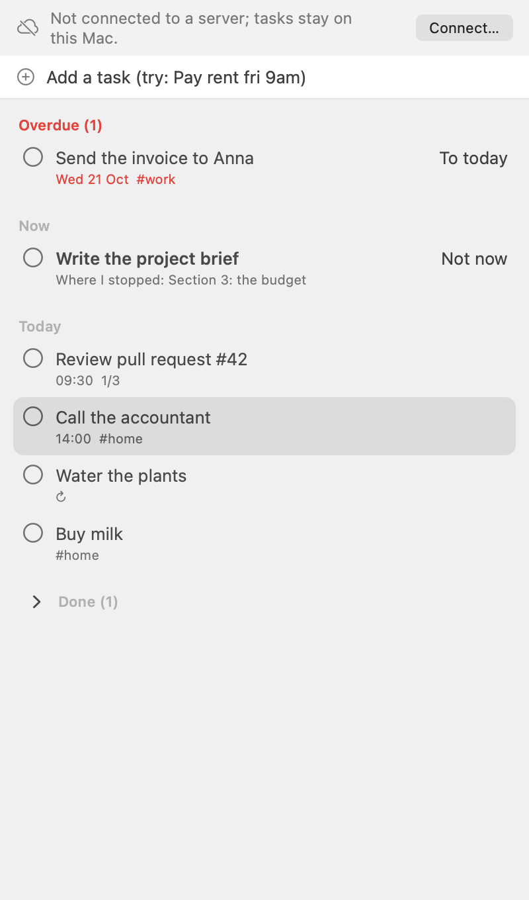

# ✋ Dayhand — a day plan with a spare pair of hands

[](LICENSE)

Dayhand is a task list and day plan for people who run a business on their own, and for the AI
agents that work for them. Your phone keeps the plan offline with a calendar and reminders; a
server you run yourself with one command lets your agent add, plan and finish tasks over MCP or
the `dayhand` command line, and every change says who made it.

```console
$ DAYHAND_API_KEY=$AGENT_KEY dayhand add "Draft the VAT reply" --due "today 16:00" --remind 30
Added:
  #3  [ ]  today 16:00  Draft the VAT reply
$ dayhand
Today, Sat 24 Oct 2026 (Europe/London)
OVERDUE (1)
  #1  [ ]  yesterday  Send the invoice to Anna  #work
TODAY
  #2  [ ]  14:00      Call the accountant       #admin
  #3  [ ]  16:00      Draft the VAT reply
```

<p align="center">
  
</p>

## Install

| Where | How | Status |
|---|---|---|
| Android 8.0+ | signed APK from GitHub Releases | prepared: the release build is signed and ready, no release is published yet |
| npm | `npx dayhand` | prepared: the publish workflow is ready, nothing is published yet ([docs/release.md](docs/release.md)) |
| Homebrew | a tap with `dayhand` | prepared: the formula template is in `packaging/homebrew/` |
| From source | below | works today on macOS and Linux (the CLI also on Windows) |

From source you need Node.js 22.12 or newer, git and, for the agent example, `jq`:

```sh
git clone https://github.com/maiarowsky/helm.git dayhand
cd dayhand/cli && npm ci --ignore-scripts && npm run build && npm link && cd ..
```

`npm link` puts `dayhand` (and its short name `dh`) on your PATH; `npm unlink -g dayhand` removes it.

## Quick start

Start your own server on this computer. No account: the first run downloads the Convex local
backend once, deploys Dayhand to it, signs `dayhand` in and prints a pairing QR code for the phone.

```sh
dayhand server start
```

Leave it running, and in a second terminal in the same folder:

```sh
dayhand add "Call the accountant" --due "today 14:00" -l admin
dayhand
dayhand done 1
```

`dayhand` alone is Today: the task you are working on now, overdue, today and done today. Dates
are English phrases in your time zone (`fri 2pm`, `in 3 days`, `2026-11-02`), all listed by
`dayhand help dates`. Stop the server with Ctrl+C; `dayhand server start` again keeps the data.

## Your agent

Give each agent its own key. Its changes are signed `agent: <name>` in the history and the
activity log, and you can revoke the key at any time (`dayhand key revoke`):

```sh
AGENT_KEY=$(dayhand key create claude --scope write --json | jq -r .key)
DAYHAND_API_KEY=$AGENT_KEY dayhand add "Draft the VAT reply" --due "today 16:00" --remind 30
dayhand log --by agent
```

Tasks can carry acceptance criteria and a plan. An agent claims a task so other agents leave it
alone, and a task with criteria is done only when they are met and the agent says what it did:

```sh
dayhand add "Send the Q4 invoices" --due "today 17:00" --accept "One PDF per client" --plan "Export, then check the totals"
DAYHAND_API_KEY=$AGENT_KEY dayhand claim 3 --minutes 30
DAYHAND_API_KEY=$AGENT_KEY dayhand criteria 3 --met all
DAYHAND_API_KEY=$AGENT_KEY dayhand done 3 --summary "3 PDFs sent" --check totals=pass
```

For agents, `--json` prints exactly what the MCP tools return ([schemas](docs/schemas)), exit
codes say what to do next, and `dayhand prime` prints Today with a short guide, ready for a
session-start hook. More: [docs/agent-work.md](docs/agent-work.md) (activity cursors,
dependencies, claims) and [docs/cli.md](docs/cli.md) (every command).

You stay in charge of your agents. Before a risky step an agent asks (`dayhand ask`, the MCP tool
`request_approval`) and you pick an option on the phone or with `dayhand approvals decide`; one
switch pauses every agent (`dayhand agents pause`); a policy per agent key allows, asks for or
denies each tool (`dayhand policy set`); work an agent or an alert proposes waits in an inbox
until you accept, merge or reject it (`dayhand proposals`); and `dayhand health`, also a card
above Today on the phone, shows what needs a look. Dayhand records your decisions; it cannot stop
what an agent does outside Dayhand.

### MCP

The server speaks [MCP](https://modelcontextprotocol.io) at `/mcp`, with the same operations as
the app. For Claude Code, with the agent key from above:

```sh
claude mcp add --transport http dayhand http://127.0.0.1:3211/mcp --header "Authorization: Bearer $AGENT_KEY"
```

Any other MCP client works the same way: the address and an `Authorization: Bearer` header.
[docs/mcp.md](docs/mcp.md) lists the tools, resources and prompts. The Claude apps connect as a
custom connector with OAuth instead, and you approve each connection on your phone
([docs/oauth.md](docs/oauth.md)); that needs a public HTTPS server (below).

There is also a ready Agent Skill that teaches an agent the `dayhand` commands:

```sh
mkdir -p ~/.claude/skills && cp -R docs/skills/dayhand ~/.claude/skills/
```

## On the phone

The Android app starts without any server: under **On this phone only** choose **Start with an
empty plan**, or **Try with sample data** (one tap removes it). Today with quick add, the week
and day calendar, the board, task details with repeats, checklists and reminders, the morning
summary and a backup file (**Settings → Data → Backup**) all work there. Without a server the
plan lives only on the phone: Android backups are off for Dayhand, so keep a backup file.

To sync the phone, the CLI and your agents, connect it to your own server: **Settings → Server →
Connect to my server**, then scan the code from

```sh
dayhand pair
```

Release builds of the app connect only over HTTPS, so a server on your computer needs
`tailscale serve` in front of it ([docs/deploy.md](docs/deploy.md#phone-and-computer-tailscale)).
Tasks you added on the phone before are sent to the server. Building the app yourself:
[android/README.md](android/README.md).

## Your own server

Dayhand has no shared server to sign up for, and the app has no built-in server address. You
run yours in one of two ways:

- **On this computer**: `dayhand server start` (above). Data and keys stay in a private folder.
- **On your own free Convex account**: `dayhand server deploy` logs in to Convex in the browser,
  deploys, signs `dayhand` in and prints the server address and a pairing code. This gives a
  public HTTPS address, which the Claude apps and a phone away from home need. Run it again to
  update; keys and data are kept.

See every step first, without changing anything:

```sh
dayhand server deploy --dry-run
```

Costs (nothing on Convex's Free plan), backups, updates, Tailscale and setup by hand:
[docs/deploy.md](docs/deploy.md). The Convex local backend binary is source-available under
FSL-1.1-Apache-2.0; it is downloaded from Convex's GitHub releases at a pinned version and its
checksum is verified.

## In the terminal

```sh
dayhand ui
```

Today, the board, the week and the trash full screen, with keys like vim and lazygit (`j`/`k`,
`h`/`l`, `?` for help), quick add with date phrases (`a`, then `Call the accountant fri 2pm
#admin`) and the mouse. Task details show who made each change, so an agent's edits stand out.
It uses the terminal's 16 colours, so it follows your theme; on Omarchy it becomes an app of its
own ([docs/omarchy.md](docs/omarchy.md)). Keys: `dayhand help ui`. The screens speak the
terminal's language when it is one of the eight the Mac app speaks (`--lang pl` or `DAYHAND_LANG=pl`
to choose); everything scripts and agents read stays English.

## On the Mac

Dayhand for macOS has Today, quick add from the menu bar or a global shortcut, reminders and the
morning summary, the trash and each task's change history, and works offline like the phone, in English, Polish, German, Spanish, French,
Brazilian Portuguese, Japanese or Simplified Chinese. It is built from source (Xcode 26 or later;
runs on macOS 13 or later) and is not signed for other Macs yet:

```sh
(cd macos && scripts/build-app.sh)
open macos/dist/Dayhand.app
```

Connect it with a code from `dayhand pair`, or choose **Not now** to keep the plan on this Mac.
More: [macos/README.md](macos/README.md) and [docs/macos.md](docs/macos.md).

## On Linux

Dayhand for Linux (Qt 6) has Today, a quick add window for a keyboard binding, a tray icon, reminders
and the morning summary as desktop notifications, works offline, and speaks eight languages. On Arch
Linux or Omarchy it is built as a package from this repository (not on the AUR):

```sh
(cd packaging/arch && makepkg -si)
```

Bind `dayhand-qt --quick-add` to a key in Hyprland and add the Omarchy theme template to follow your
theme's colours: [docs/linux.md](docs/linux.md). More: [linux/README.md](linux/README.md).

## The name

Dayhand was called Helm until backend 0.9.0 and CLI 0.10.0; the old `hlm` command and `HELM_*`
names still work with a warning ([docs/rename.md](docs/rename.md)). An unrelated to-do app called
DayHand exists for iPhone, iPad and Mac ([amouraux/DayHand](https://github.com/amouraux/DayHand),
in public TestFlight beta in October 2026). If it reaches the App Store first, this project's
Apple apps would be listed as "Dayhand Planner"; the CLI, npm, Homebrew and Android are not
affected.

## Development

```
backend/   Convex backend: data model, domain operations, MCP endpoint, REST API, webhooks
cli/       dayhand, the command line for people and agents
android/   Android app (Kotlin, Compose)
macos/     Dayhand for macOS (Swift, SwiftUI)
linux/     Dayhand for Linux (Qt 6, QML); see docs/linux.md
docs/      architecture, MCP, REST API, webhooks, OAuth, calendar feed, pairing, deployment
```

The tests start their own throwaway backend:

```sh
(cd backend && npm ci --ignore-scripts && npm test)
(cd cli && npm test)
```

Every command in this README runs against a local backend with sample data in
`scripts/verify-readme.sh`. Contributions are accepted under the
[Developer Certificate of Origin](CONTRIBUTING.md).

## Help

Start with `dayhand help`, [docs/cli.md](docs/cli.md) and [docs/deploy.md](docs/deploy.md).
Dayhand is a personal project with no hosted service and no support promise; issues are for bugs
you can reproduce and for feature ideas. Security problems go privately, never in an issue
([SECURITY.md](SECURITY.md)).

## License

[Apache License 2.0](LICENSE).
